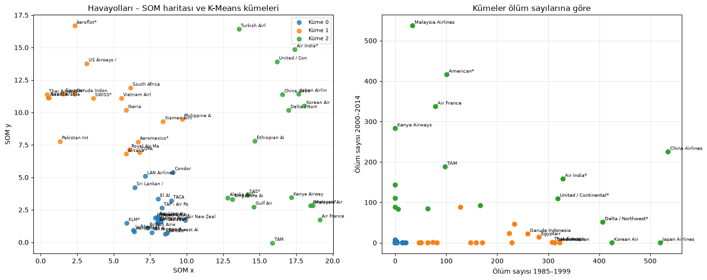
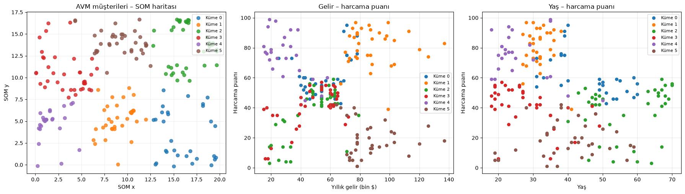
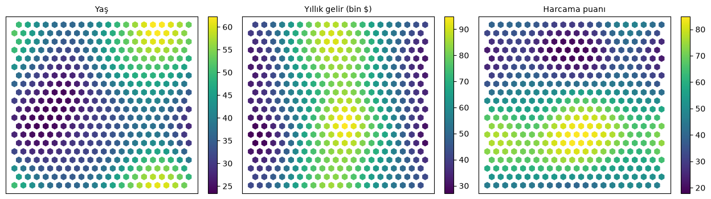
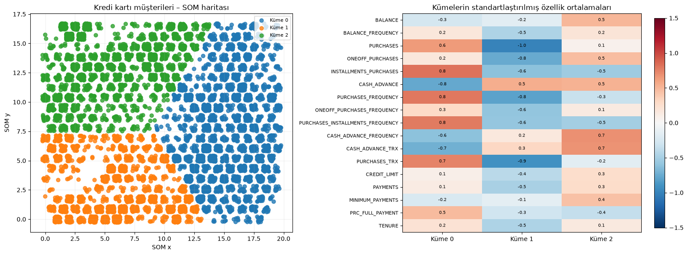
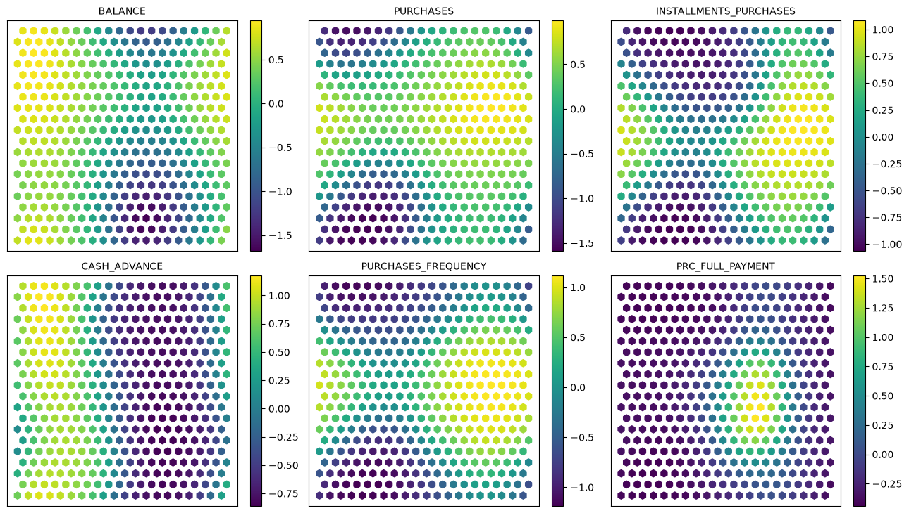

# SOM ile Kümeleme: Havayolu Güvenliği, AVM Müşterileri ve Kredi Kartı Kullanıcıları

> Fırat Üniversitesi · YMH451 Yapay Zeka · Uygulama 5
> Python · SimpSOM · scikit-learn

Bu çalışmada üç veri setini **öz-düzenleyici harita (SOM)** ile 2 boyutlu bir haritaya yerleştirip K-Means ile kümeledim:

1. **Havayolu güvenliği** (uygulamanın kendisi): 56 firma, 30 yıllık kaza/ölüm sayıları → güvenli / orta / riskli.
2. **AVM müşterileri** (Soru 1): 200 müşteri, yaş + gelir + harcama puanı → pazarlama segmentleri.
3. **Kredi kartı kullanıcıları** (Soru 2): 8950 müşteri, 17 davranış özelliği → kullanım segmentleri.

Veride etiket yok; SOM benzer örnekleri haritada yan yana koymayı kendi başına öğreniyor. Ben de haritadaki konumlara göre kümeleri çıkarıp her kümenin profilini yorumladım.

---

## Kısaca sonuçlar

| | Amaç | Sonuç |
|---|---|---|
| **Uygulama** | 56 havayolunu güvenlik seviyesine göre kümelemek | 21 güvenli / 18 orta / 17 riskli. SOM aslında "eskiden kötü, sonra düzelen" ile "iki dönemde de ölümlü kaza" ayrımını yapmış |
| **Ek** | Aynı ağı uçuş hacmine göre normalize edilmiş veriyle eğitmek | "Riskli" listesi tamamen değişti: ham sayılarla riskli görünen Air France, American, United ortaya geçti; Aeroflot, Garuda, Pakistan International riskliye |
| **Soru 1** | AVM müşterilerini segmentlere ayırmak | **6 segment**: "zengin ve çok harcayan", "zengin ama harcamayan", "genç ve harcayan"… SOM, ortadaki büyük grubu yaşa göre böldü |
| **Soru 2** | Kredi kartı kullanıcılarını segmentlere ayırmak | **3 segment**: alışverişçiler (%41), borç taşıyanlar (%31), pasifler (%28) |

---

## SOM nasıl çalışıyor?

- 20×20 = 400 nöronluk bir ızgara; her nöronun girdiyle aynı boyutta bir ağırlık vektörü var.
- Her epokta rastgele bir örnek alınıyor, ona en yakın nöron (**BMU**) ve komşuları örneğe doğru çekiliyor: `w ← w + η·h·(x − w)`.
- Öğrenme katsayısı ve komşuluk yarıçapı zamanla küçülüyor; 10000 epok sonunda benzer örnekler haritada yan yana toplanıyor.
- Her örneğin BMU koordinatı alınıp (`net.project`) bu 2 boyutlu noktalar **K-Means** ile kümeleniyor. SOM boyut indirgeme ve topoloji koruma işini, K-Means son sınırları çizme işini yapıyor.

Uygulama föyündeki kodu birebir kullandım (SimpSOM 1.3.4: `somNet(20, 20, X, PBC=True)` → `train(0.01, 10000)` → `project`). Kütüphane yeni NumPy'de kaldırılan `np.float`'u kullandığı için not defterinin başında `np.float = float` satırı var.

---

## Uygulama: Havayolu güvenliği

**Girdiler:** 1985–1999 ve 2000–2014 dönemleri için kaza, ölümcül kaza, ölüm sayıları (6 özellik). Firma adı ve uçuş hacmi girdiye alınmıyor.

**Föyden farkım:** Föyde "en iyi firmalar 1 numaralı kümede" deniyor. Küme numaraları rastgele olduğu için kümeleri **ortalama değerlerine** göre sıralayıp güvenli / orta / riskli adını sayısal olarak verdim. "En iyi firma" için de güvenli küme içinde **milyar koltuk-km başına olay** sayısına baktım: TAP – Air Portugal (30 yılda sıfır olay), Cathay Pacific, Virgin Atlantic.

**Ne oldu:** Güvenli küme iki dönemde de sıfıra yakın ölümle ayrışıyor. Orta ve riskli kümeler 1985–1999'da birbirine çok benziyor (175 vs 181 ölüm); ikisini ayıran şey 2000–2014 dönemi (11 vs 171 ölüm). Sağdaki grafikte turuncu noktalar sadece x ekseninde, yeşiller y ekseninde yüksek.

<p align="center"></p>

**Ek: ölçekleme.** Ham sayılarla "riskli" kümede Air France, American, Delta, United gibi en büyük firmalar var; çünkü çok uçan firmanın toplam olay sayısı doğal olarak yüksek. Sayıları uçuş hacmine bölüp standartlaştırınca ham "riskli" 17 firmadan sadece 4'ü riskli kaldı; oranlarla riskli çıkan 13 firma (Aeroflot, Avianca, Ethiopian, Garuda, Pakistan International…) havacılık literatüründe de sorunlu sayılan firmalar. Hangi ön işlemenin doğru olduğuna veri değil, soru karar veriyor: "toplamda kaç kişi öldü" ile "bu firmayla uçmak ne kadar riskli" farklı kümeler veriyor.

---

## Soru 1: AVM müşterileri

**Veri:** [Mall Customers](https://www.kaggle.com/shwetabh123/mall-customers) · 200 müşteri · yaş, yıllık gelir (bin $), harcama puanı (1–100). Üç özellik `StandardScaler` ile aynı ölçeğe getirildi.

**Küme sayısı:** Föydeki gibi önceden belli değildi. k = 2…8 için dirsek + siluet skoruna baktım. Siluet, harita koordinatlarında k ile monoton artıyor (K-Means 2 boyutlu haritayı istediği kadar bölebiliyor); asıl özellik uzayında 4'ten sonra düzleşiyor. 8 kümede segmentler 15–20 kişiye düşüp aynı bölgeyi tekrar böldüğü için **6** seçtim.

| Küme | Kişi | Profil | Anlamı |
|---|---|---|---|
| 1 | 34 | 32 yaş, gelir 89k, puan 80 | **Hedef müşteri** |
| 5 | 35 | 40 yaş, gelir 87k, puan 18 | **Kazanılabilir potansiyel**: parası var, harcamıyor |
| 4 | 25 | 26 yaş, gelir 30k, puan 75 | Genç, düşük gelirli, çok harcıyor |
| 3 | 37 | 28 yaş, gelir 47k, puan 40 | Genç, orta gelir, orta-az harcama |
| 0 | 30 | 45 yaş, gelir 56k, puan 62 | Orta yaş, orta gelir, ortanın üstü |
| 2 | 39 | 57 yaş, gelir 48k, puan 37 | Yaşlı, orta gelir, az harcama |

Klasik K-Means bu veriyi gelir–puan düzleminde 5 kümeye ayırır. SOM üç özelliği birlikte kullandığı için ortadaki büyük grubu **yaşa göre** üçe böldü: gelir–puan grafiğinde bu üçü üst üste, yaş–puan grafiğinde ayrışıyor.

<p align="center"></p>
<p align="center"></p>

Bileşen düzlemleri: her nöronun bir özelliğe ait ağırlığı. Harcama puanı haritanın alt yarısında, gelir ortasında, yaş sağ kenarlarda yüksek; kümeler bu bölgelerin kesişimleri.

---

## Soru 2: Kredi kartı kullanıcıları

**Veri:** [Credit Card Dataset](https://www.kaggle.com/arjunbhasin2013/ccdata) · 8950 müşteri · 17 özellik (bakiye, alışveriş tutarları, nakit avans, sıklıklar, limit, ödemeler…).

**Ön işleme:** `MINIMUM_PAYMENTS` (313) ve `CREDIT_LIMIT` (1) eksikleri medyanla dolduruldu. Tutar sütunları çok çarpık olduğu için `log1p`, sonra tüm sütunlar `StandardScaler`. Bunu yapmazsak bakiye (binler) sıklıkları (0–1) Öklid uzaklığında tamamen bastırır.

**Küme sayısı:** Harita koordinatlarında siluet k = 3'te en yüksek (0.445). Özellik uzayındaki siluet düşük (0.14): 17 boyutlu davranış verisinde müşteriler keskin gruplar değil, bir süreklilik hâlinde; SOM bu sürekliliği 2 boyuta açıyor.

| Küme | Kişi | Davranış | Banka için anlamı |
|---|---|---|---|
| 0 | 3685 (%41) | Alışveriş sıklığı 0.92, taksitli alışveriş yüksek, nakit avans 0, bakiye düşük, tam ödeme en yüksek | **Ödeme aracı kullanıcıları**: risk düşük, komisyon geliri yüksek |
| 2 | 2745 (%31) | Bakiye en yüksek (1759), nakit avans 1009, tam ödeme 0, asgari ödeme yüksek | **Borç taşıyanlar**: faiz geliri yüksek, temerrüt riski yüksek |
| 1 | 2520 (%28) | Alışveriş 0, limit düşük, ödeme düşük, kart süresi kısa | **Pasifler**: aktivasyon kampanyası hedefi |

<p align="center"></p>
<p align="center"></p>

Bileşen düzlemlerinde nakit avans haritanın sol yarısında, alışveriş sağ yarısında yüksek; SOM iki davranışı haritanın iki yarısına ayırmış, K-Means de bu sınırı izlemiş. Sol yarı bakiyeyle üst/alt bölünüyor: üstte borç taşıyanlar, altta pasifler.

---

## Neler öğrendim

- **SOM = boyut indirgeme + topoloji koruma.** Harita koordinatlarına K-Means uygulamak, asıl veriye uygulamaktan farklı sonuç verebilir (Soru 1'de ortadaki grubun yaşa göre bölünmesi).
- **Ölçekleme şart.** SOM da K-Means de Öklid uzaklığı kullanıyor; büyük değerli sütunlar küçükleri bastırıyor. Ek bölüm bunun somut kanıtı.
- **Küme numarası anlamsız, profil anlamlı.** 0/1/2 rastgele; her kümenin ortalamasına bakıp isim vermek gerekiyor.
- **Siluet tek başına yetmez.** Harita koordinatlarında k ile monoton artabiliyor; özellik uzayındaki skor ve yorumlanabilirlikle birlikte değerlendirdim.
- **SimpSOM yavaş.** Saf Python döngüsü: 56 örnek için 1 dakika, 8950 örnek için 8 dakika (projeksiyon adımı). Daha büyük veride MiniSom gibi NumPy tabanlı bir kütüphane gerekir.

---

## Dosyalar

| Dosya | İçerik |
|---|---|
| `Uygulama5_YSA_SenaKose.ipynb` | Çalıştırılmış not defteri (kod + grafikler + yorumlar) |
| `Uygulama5_YSA_SenaKose.py` | Aynı kodun markdown'ları yorum satırına çevrilmiş tek dosya hâli |
| `airline-safety.csv`, `Mall_Customers.csv`, `CC_GENERAL.csv` | Veri setleri |
| `gorseller/` | README'deki grafikler |

## Çalıştırma

```bash
python -m venv .venv && source .venv/bin/activate
pip install -r requirements.txt
jupyter lab Uygulama5_YSA_SenaKose.ipynb
```

Python 3.12 ile test edildi. SimpSOM 1.3.4 yeni NumPy'de `np.float` hatası verir; not defterindeki `np.float = float` satırı bunu çözer. Tüm hücreler ~12 dakikada çalışır (en uzun adım kredi kartı verisinin haritaya yerleştirilmesi).
